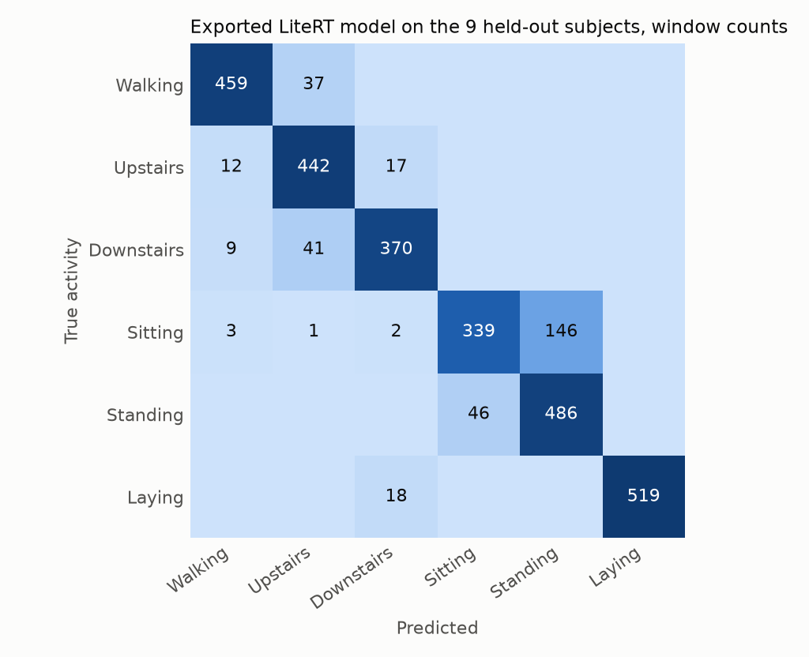
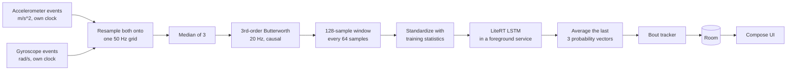
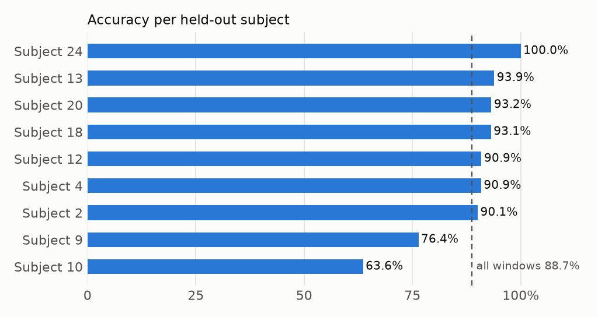
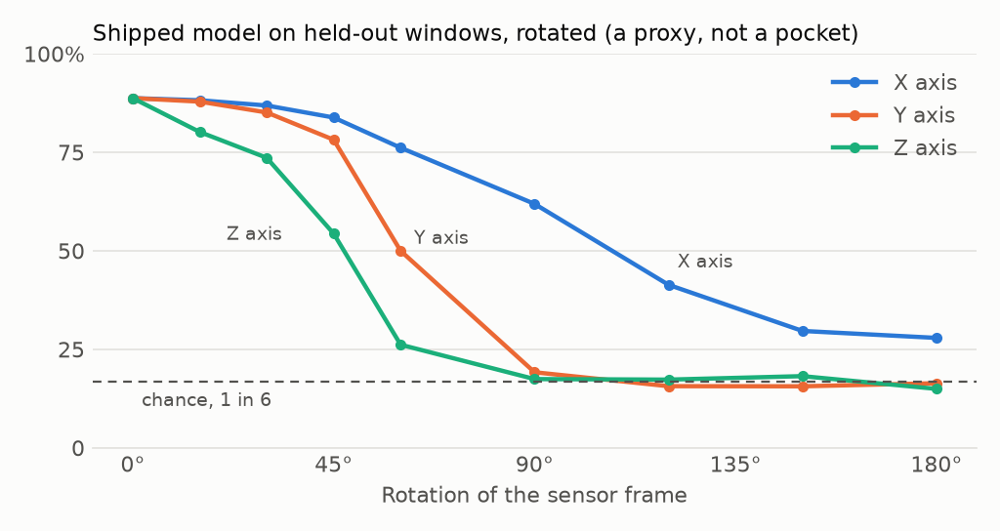

# StrideSense

[](https://github.com/matejpopovski/StrideSense/actions/workflows/ci.yml)

An Android app that works out what you are doing from the phone's accelerometer and gyroscope and
logs your day, with a self-trained LSTM running on the device through LiteRT. Nothing leaves the
phone: a foreground service asks for 50 Hz, the model scores a 2.56 s window every 1.28 s, and Room
stores the result as bouts of walking, stairs, sitting, standing and lying down.

| Exported LiteRT model, 9 subjects it never saw | |
|---|---|
| Accuracy over 2,947 windows | **88.7%** |
| Macro F1 | 0.886 |
| Per person | 63.6% to 100.0%, mean 88.0% |
| Model file | 974 KB, 52,102 parameters |
| Agreement with the PyTorch model | 100.00% of windows |

**Read this before the number above.** The training data was collected with phones worn sideways on
a belt. A phone upright in a pocket reads gravity on a different axis, and rotating the held-out data
to match takes this model from 88.7% to 17.4%, which is chance for six classes. So this is
a waist-worn recognizer, not a pocket one. The app has never run on a phone or an emulator, and
its real-world accuracy is unmeasured.



## Screenshots

TODO: add the images from the `roborazzi-screenshots` artifact of the first green CI run. They will
come from Roborazzi rendering the real composables. None exist yet, and none will be drawn by hand.

## Why the headline is lower than most UCI HAR write-ups

Split UCI HAR at random and the same person lands on both sides, with windows that overlap by 50%,
so the model is graded partly on signal it memorized. Doing that here scores
**93.7%**. Keeping people apart scores **88.8%** across 5 seeds. The
gap is the difference between recognizing a stranger and recognizing a training subject, and an app
only ever meets strangers. Everything below uses the dataset's official split of 21 training
subjects and 9 test subjects. Early stopping and every tuning choice used 5 people held out from the
21, so the 9 stayed out of model selection.

The test subjects were not fully untouched, and that should be stated plainly: the first baseline
run printed its test scores before tuning began. Tuning decisions were then made on validation
subjects with test scoring switched off, and the baseline is reported below as the run it was.

For reference, the dataset authors reach 96% on these same 2,947 test windows with a multiclass SVM
over 561 hand-built features ([Anguita et al., 2013](https://www.esann.org/sites/default/files/proceedings/legacy/es2013-84.pdf)).
That beats this model. Those features are built on signals the authors separated before cutting
windows, and a phone has to work one event at a time. The next section is about that constraint.

## The real work is matching training on a phone

A model is only as good as the agreement between what it was trained on and what it receives. UCI
HAR arrives as tidy 128-sample windows in units of g. A phone delivers two unsynchronized event
streams in m/s^2, at a rate the OS treats as a suggestion.



`core/` is pure Kotlin with no Android dependency, so this whole path up to the model can be built
and tested on any JVM. `ml/preprocess.py` is the reference it must match. The Python side sees a
whole recording while the Kotlin side sees one event at a time, so the fixtures are a real check on
the streaming logic, not two copies of one loop. On five scenarios built from held-out recordings
(jitter, fast sensors, a late-starting gyroscope, a dropout, repeated timestamps) the worst
difference between Kotlin and Python across every window is **2.7e-15**
(`results/parity.json`). A test also confirms the fixtures have teeth: rounding gravity to 9.81,
shifting the stride by one, starting the filter from zero and similar porting mistakes each fail.

Decisions worth defending:

- **Six channels, not nine.** The dataset's `body_acc` signal comes from a 0.3 Hz filter its authors
  ran before windowing, without saying whether it was causal, so a live version on a phone could not
  be shown to match it. The model takes `total_acc` and the gyroscope instead, which a phone produces
  directly. Measured cost: 88.8% with six channels against 89.2% with all nine, a
  gap smaller than the nine-channel model's own seed-to-seed spread.
- **Settled filter start.** A filter that starts at zero rings for several samples on the 1 g of
  gravity. Both implementations seed the state from the first sample, using `filter_zi`.
- **Filters copied from a description.** The dataset documents a median filter and a 3rd-order
  20 Hz Butterworth, but not the median length or whether either ran causally. The phone uses a
  causal median of 3 and a causal Butterworth, so this stage is a best match and not a proven one.
- **A gap ends the run.** If a sensor goes quiet for over 200 ms, the pipeline resets instead of
  drawing a straight line across the hole. Interpolating there would invent motion.
- **A standard `nn.LSTM`, exported through `litert-torch`.** It unrolls over 128 steps into
  4,098 builtin operators. That is a large graph for a small model, but it uses no Flex ops, so
  the app needs no extra native library. A hand-written Keras twin would produce the compact
  `UNIDIRECTIONAL_SEQUENCE_LSTM` op, at the cost of keeping a second model definition in step.
- **Rotation jitter as augmentation.** Random turns of up to 30 degrees stop the network memorizing
  how each person's phone sat on their belt. Validation macro F1 rose from 0.865 to
  0.897, and test accuracy became far steadier: its spread across seeds fell from
  2.5 points to 0.3. Dropout alone, a slower learning rate, a smaller network
  and a single LSTM layer all scored lower on validation.
- **Normalization ships as data.** `preprocessing.json` is written by the export step beside the
  model and carries its SHA-256, so the app cannot pair a new model with old statistics.

## Results

All reproducible with the commands further down. The numbers come from `results/test_metrics.json`,
`results/experiments.json`, `results/replay.json` and `results/orientation.json`.

**The exported model.** Seed 4 was picked by validation score. LiteRT and PyTorch agree on
100.00% of windows, with a largest probability difference of 4.2e-06, so the headline numbers
describe the file the app loads. Latency was 0.84 ms at the median and 1.17 ms at p95 on one thread
of an Apple M3 Max, through the Python runtime. That is a host measurement and says little about a
phone.

| Activity | Recall | F1 |
|---|---|---|
| Walking | 92.5% | 0.938 |
| Upstairs | 93.8% | 0.891 |
| Downstairs | 88.1% | 0.895 |
| Sitting | 69.0% | 0.774 |
| Standing | 91.4% | 0.835 |
| Laying | 96.6% | 0.983 |

**Per person.** The overall figure hides a wide spread (standard deviation 11.1 points):

| Subject | Windows | LiteRT accuracy | Macro F1 | PyTorch accuracy |
|---|---|---|---|---|
| 10 | 294 | 63.6% | 0.636 | 63.6% |
| 9 | 288 | 76.4% | 0.758 | 76.4% |
| 2 | 302 | 90.1% | 0.883 | 90.1% |
| 4 | 317 | 90.9% | 0.901 | 90.9% |
| 12 | 320 | 90.9% | 0.905 | 90.9% |
| 18 | 364 | 93.1% | 0.928 | 93.1% |
| 20 | 354 | 93.2% | 0.939 | 93.2% |
| 13 | 327 | 93.9% | 0.934 | 93.9% |
| 24 | 381 | 100.0% | 1.000 | 100.0% |



**Why some people score low.** 58% of all errors confuse sitting with standing. Both are still, so the only cue is the direction of gravity, and across the training subjects the two postures differ by a tilt of 20.9 degrees. For subject 10 that tilt is 10.7 degrees and for subject 9 it is 5.2, the two smallest in the test set, and they are the two lowest scores. Subject 24, at 20.7 degrees, scores 100%. Across the nine people, tilt correlates -0.73 with the sit-stand confusion rate (`results/failure_analysis.json`). Nine people prove nothing on their own, but this points at how the phone sat on the person rather than at the network.

**Experiments.** Same network size and training budget throughout. Rows are means over seeds, so the
shipped row differs slightly from the single exported model above. Note that nine channels also led
on validation, by less than a seed's worth of noise on test.

| Run | Seeds | Validation macro F1 | Test accuracy |
|---|---|---|---|
| First baseline, no jitter | 5 | 0.865 | 87.1% (std 2.5) |
| Shipped: six channels, 30 degree jitter | 5 | 0.897 | 88.8% (std 0.3) |
| Nine channels, offline `body_acc` included | 3 | 0.906 | 89.2% (std 0.9) |
| Trained on every orientation | 3 | 0.491 | 56.1% (std 6.4) |
| Random window split, for contrast (leaky) | 3 | 0.948 | 93.7% (std 1.0) |

**The device path.** Scoring pre-cut windows says nothing about the code the phone runs, so held-out
recordings were rebuilt from the overlapping windows (257 of them), turned into
simulated sensor events and sent through the Python reference of the whole path into the LiteRT
model. These are simulated events, not a device. The recordings were filtered by the dataset authors,
so the 20 Hz filter runs a second time here. Each recording also loses its final window to clock
trimming, so these scores cover slightly fewer windows than the 88.7% from direct scoring.

| Simulated sensors | Each window | Smoothed over 3 |
|---|---|---|
| 50 Hz, 1 ms jitter | 88.7% | 89.8% |
| 50 Hz, 4 ms jitter | 88.6% | 89.8% |
| 40 Hz, 2 ms jitter | 88.6% | 89.7% |
| 100 Hz, 1 ms jitter | 88.6% | 89.6% |

**Orientation.** In this data mean gravity while standing is (1.00, -0.17, 0.02) g in phone axes, so
upright means +x: the phone sat sideways on the belt. These rows rotate the held-out windows and
score them again. This is a proxy for one failure and not a measurement of a pocket, where a thigh
also moves differently from a hip. Both columns show the seed with the best validation score, which
is why the right column beats that experiment's mean above.

| Phone pose (simulated by rotation) | Shipped | Trained on every orientation |
|---|---|---|
| Sideways at the waist, as trained | 88.7% | 63.6% |
| Upright, portrait | 17.4% | 51.2% |
| Upside down, portrait | 17.6% | 49.5% |
| Sideways, flipped end for end | 15.0% | 36.4% |
| Uniformly random | 24.2% | 50.1% |



## Gravity-aligned input: a negative result

The obvious answer to the placement problem is to stop giving the model anything tied to the phone's
axes. This experiment estimates gravity as the mean acceleration in each window, then feeds vertical
motion, horizontal motion and gyroscope magnitude. Whether it replaced the shipped model was decided
by a rule set before any test score existed: at least 75% in the worst simulated rotation and at
least 80% at the waist, choosing on validation subjects with test scoring off. It missed both, so
the waist model stays. Everything here is in `results/gravity_aligned.json`.

| 9 held-out subjects | Waist model (shipped) | Gravity-aligned |
|---|---|---|
| At the waist | 88.7% | 63.5% |
| Worst simulated rotation | 15.0% | 63.5% |

These rotations are simulated by turning held-out windows in software, and none of this measures a
phone in a pocket. The gravity-aligned score does not move at all under rotation because the channels
cancel a fixed rotation by construction, so that row confirms the arithmetic and little else.

| Activity | Recall, waist model | Recall, gravity-aligned | F1, waist model | F1, gravity-aligned |
|---|---|---|---|---|
| Walking | 92.5% | 97.6% | 0.938 | 0.971 |
| Upstairs | 93.8% | 94.9% | 0.891 | 0.945 |
| Downstairs | 88.1% | 96.2% | 0.895 | 0.972 |
| Sitting | 69.0% | 0.0% | 0.774 | 0.000 |
| Standing | 91.4% | 0.0% | 0.835 | 0.000 |
| Laying | 96.6% | 100.0% | 0.983 | 0.512 |

The tilt signal was the whole difference between still postures. Without it the model calls every
still window laying, so sitting and standing fall to zero, and the laying recall of 100% is an
artefact of that. Motion got better, though. Count sitting, standing and laying as one class and
the gravity-aligned model reaches 98.2% against 95.2% for the waist model at the waist.
That comparison was only made after seeing test scores, so it is an observation and not a result.

**The trap in this experiment.** The first four variants looked much better, because they kept the
level of the vertical channel. One seed of the best scored 84.8% at the waist and the same
under every simulated rotation, which would have passed the rule. Measured gravity should not depend
on posture, yet on training subjects it reads 1.033 g standing and 1.007 g laying:
each sensor axis has its own calibration error, so the level quietly reports which axis faces up, and
that number alone separates laying from sitting and standing 87.9% of the time. Rotating
numbers in software preserves that level, while turning a real phone would not, so the rotation test
cannot see the leak. Those variants were ruled out on training data before any test scoring.
Holding the level constant afterwards took that model from 84.8% to 61.3%, which
accounts for its entire lead. Anything scored only by software rotation deserves the same suspicion.

## What has and has not been verified

The Android module was written on a machine with no Android SDK, so it has only ever been compiled
in full on GitHub Actions.

| Layer | How it is checked |
|---|---|
| Training, export, LiteRT scoring | Run locally, results in `results/` |
| Committed model and golden outputs | `pytest`, on the LiteRT Python runtime, with no torch or dataset |
| Preprocessing, windowing, bouts, Kotlin-Python parity | JUnit on a plain JVM, in `core/` |
| Room, foreground service, Compose UI | Robolectric, on CI |
| Rendered screens | Roborazzi, on CI, from hand-written sample state rather than a recorded day |
| The real interpreter on Android | `LiteRtClassifierInstrumentedTest` is compiled by CI but has never run |
| A phone or emulator | Never |

The last two rows are a real gap. LiteRT ships only Android native libraries, so a JVM test cannot
load the interpreter, and Robolectric tests use a fake classifier. Python's LiteRT runtime and the
golden file cover the model itself, but the Kotlin wrapper around the interpreter is unproven until
that instrumented test runs on a device.

## Run it

Python 3.12 and [uv](https://docs.astral.sh/uv/) for the model, a JDK for the rest. Gradle comes
from the wrapper. These commands need neither the dataset nor an Android SDK:

```bash
uv sync --locked
uv run pytest
./gradlew -p core ktlintCheck test --no-daemon
```

To reproduce the model and every number. Apart from the gravity-aligned experiment, the runs below
took 92 minutes of training in total on CPU, on an Apple M3 Max:

```bash
uv sync --locked --group train
uv run python scripts/download_uci_har.py
uv run python -m ml.train --experiment baseline --seeds 0 1 2 3 4
uv run python -m ml.train --experiment shipped --seeds 0 1 2 3 4
uv run python -m ml.train --experiment all9 --seeds 0 1 2
uv run python -m ml.train --experiment leaky_random_split --seeds 0 1 2
uv run python -m ml.train --experiment rotation_augmented --seeds 0 1 2
for e in dropout5 slow jitter15 jitter30 hidden32 1layer; do
  uv run python -m ml.train --experiment tune_$e --seeds 0 1 --validation-only
done
uv run python -m ml.export_litert --experiment shipped
uv run python -m ml.evaluate
uv run python -m ml.replay
uv run python -m ml.orientation
uv run python -m ml.failure_analysis
uv run python -m ml.make_fixtures
uv run python -m ml.plots
for e in aligned4 aligned3 log log_dropout3 dynamic3 dynamic3_log; do
  uv run python -m ml.train --experiment gravity_tune_$e --seeds 0 1 --validation-only
done
uv run python -m ml.train --experiment gravity_final --seeds 0 1 2 3 4
uv run python -m ml.train --experiment gravity_leaky_comparison --seeds 0 1 2 3 4
uv run python -m ml.gravity_experiment
```

The app needs the Android SDK with API 36 and JDK 21:

```bash
./gradlew :app:assembleDebug
./gradlew :app:testDebugUnitTest
./gradlew :app:recordRoborazziDebug
```

These three commands have only been run by CI, not on the machine this was written on.

## Limitations

- **Placement.** The model expects a phone sideways at the waist. Upright in a pocket, in a hand or
  in a bag is outside its training data. Training on every orientation is not a free fix: that model reaches
  about 50.1% in any pose, but falls to 63.6% at the waist.
- **Real-world accuracy is unmeasured.** No figure here comes from a person using the app.
- **Six classes, no "other".** Running, cycling, driving and anything else get forced into one of
  the six. The confidence shown does not fix that: a model can be sure and wrong about something it
  never saw.
- **30 people in a lab,** aged 19 to 48, following a protocol. Nine test subjects give a small sample
  of how people vary, which the per-person table shows.
- **Sitting and standing are mostly a matter of phone tilt** and will stay the weakest pair.
- **Battery use is unmeasured.** The service holds a partial wake lock for up to 16 hours, because
  sensors otherwise stop when the screen does. Expect it to cost real battery.
- **On-device latency is unmeasured.** The unrolled graph may be slower on a phone than its parameter
  count suggests.
- **No bout history beyond today** is shown in the UI, though every bout stays in the database.

## Data and licence

Code is MIT, see `LICENSE`. The MIT licence does not extend to the dataset, and the model weights and
fixtures are derived from it.

Human Activity Recognition Using Smartphones, by Jorge Reyes-Ortiz, Davide Anguita, Alessandro Ghio,
Luca Oneto and Xavier Parra, from the [UCI Machine Learning Repository](https://doi.org/10.24432/C54S4K).
The raw dataset is not committed, and `scripts/download_uci_har.py` fetches it. A few windows appear
in `fixtures/` and `app/src/androidTest/assets/`, and the shipped model is trained on it.

The two licence statements attached to this dataset differ. The UCI page lists Creative Commons
Attribution 4.0. The `README.txt` inside the archive says use in publications must cite Anguita et
al. (2013) and that "Any commercial use is prohibited". This repository credits both and is a
non-commercial project. Treat the model weights accordingly.

Davide Anguita, Alessandro Ghio, Luca Oneto, Xavier Parra and Jorge L. Reyes-Ortiz. A Public Domain
Dataset for Human Activity Recognition Using Smartphones. 21st European Symposium on Artificial
Neural Networks, Computational Intelligence and Machine Learning, ESANN 2013. Bruges, Belgium,
24-26 April 2013.
